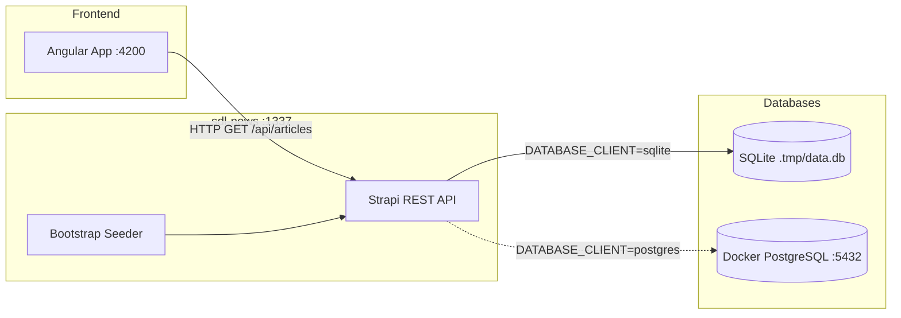

# Requirements

### Overview & Goals
When executing `npm run start` in `sdl-news`, Strapi fails to start and throws `connect ECONNREFUSED 127.0.0.1:5432`. This occurs because Strapi is configured to attempt connecting to a local PostgreSQL instance on port 5432, but no PostgreSQL server is running, and required environment variables and database fallback drivers (such as `better-sqlite3` for zero-config SQLite) are not fully configured.

The goal is to provide a robust, resilient database configuration and startup setup for `sdl-news` that:
1. Works out of the box with zero external dependencies using SQLite for local development.
2. Supports running PostgreSQL via Docker Compose for production-parity testing.
3. Automatically sets up required environment secrets and configuration defaults.
4. Provides convenient workspace commands in the root `package.json`.

### Scope
- **In Scope**:
  - Adding `better-sqlite3` to `sdl-news` dependencies for embedded database execution.
  - Generating and maintaining `sdl-news/.env` and updated `sdl-news/.env.example` with valid secret keys and database client settings.
  - Adding a `docker-compose.yml` file to run PostgreSQL 16 locally on port 5432 when PostgreSQL mode is desired.
  - Updating `config/database.ts` and `sdl-news/package.json` scripts.
  - Adding root-level scripts in `package.json` to launch the Strapi backend and Angular frontend smoothly.
- **Out of Scope**:
  - Modifying the existing `Article` content type schema or Angular `NewsService` logic (already implemented and tested).
  - Production cloud infrastructure provisioning (AWS RDS / Strapi Cloud).

### User Stories
- **As a developer**, I want to run `npm run develop` or `npm run start` in `sdl-news` immediately after cloning the repository without needing to configure or start external database services.
- **As a developer**, I want the option to spin up a local PostgreSQL container using Docker Compose when I need to test with PostgreSQL before deployment.
- **As a developer**, I want clear error messaging and documentation for managing database configurations.

### Functional Requirements
- **FR-1: Default Zero-Config Startup**: Running `npm run develop` or `npm run start` in `sdl-news` with default settings must use SQLite (`.tmp/data.db`) and start Strapi successfully without database connection errors.
- **FR-2: Environment Configuration**: Strapi must load valid secrets (`APP_KEYS`, `API_TOKEN_SALT`, `ADMIN_JWT_SECRET`, `TRANSFER_TOKEN_SALT`, `JWT_SECRET`, `ENCRYPTION_KEY`) from `.env`.
- **FR-3: Docker PostgreSQL Service**: A `docker-compose.yml` file must provide a PostgreSQL service configured to listen on port 5432 with credentials `strapi / strapi / strapi`.
- **FR-4: Dual Database Support**: Switching `DATABASE_CLIENT=postgres` in `.env` must seamlessly connect to the PostgreSQL instance when running.

### Non-Functional Requirements
- **Reliability**: No unhandled connection errors on startup; graceful warnings and fallbacks.
- **Developer Experience**: One-command startup for local development.
- **Security**: Development secrets separated into `.env` (ignored by git), with `.env.example` providing templates.

# Technical Design

### Current Implementation
- `sdl-news/package.json` has `pg: 8.20.0` installed, but does not have `better-sqlite3`.
- `sdl-news/config/database.ts` defines `client = env('DATABASE_CLIENT', 'sqlite')` and configures connections for `mysql`, `postgres`, and `sqlite`.
- When `.env` is absent or `DATABASE_CLIENT` defaults to `postgres` in environment / Strapi runtime, Strapi attempts TCP connection to `127.0.0.1:5432`, failing with `ECONNREFUSED`.
- `sdl-news/config/admin.ts` and `sdl-news/config/server.ts` require non-null environment variables (`ADMIN_JWT_SECRET!`, `API_TOKEN_SALT!`, `APP_KEYS!`), which crash if `.env` is missing.

### Key Decisions
1. **Default to SQLite with `better-sqlite3`**:
   - *Decision*: Install `better-sqlite3` in `sdl-news` and set `DATABASE_CLIENT=sqlite` by default.
   - *Rationale*: Eliminates external dependencies for new contributors and frontend developers who just need news API mock/content serving.
2. **Docker Compose for PostgreSQL**:
   - *Decision*: Provide `docker-compose.yml` configured for PostgreSQL 16 on port 5432.
   - *Rationale*: Provides a 1-command reproducible PostgreSQL database environment for developers who want Postgres compatibility without manual installation.
3. **Automated `.env` generation**:
   - *Decision*: Provide standard development keys in `sdl-news/.env` and document them in `sdl-news/.env.example`.
   - *Rationale*: Prevents Strapi startup crashes caused by non-null assertion on missing JWT/salt tokens.

### Proposed Changes

#### 1. `sdl-news/package.json`
- Add `better-sqlite3: ^11.8.1` (or matching Strapi 5 compatible version) to `dependencies`.

#### 2. `sdl-news/.env` and `sdl-news/.env.example`
- Define full default environment configuration:
  ```env
  HOST=0.0.0.0
  PORT=1337
  APP_KEYS="sdlAppKey1,sdlAppKey2,sdlAppKey3,sdlAppKey4"
  API_TOKEN_SALT="sdlApiTokenSalt1234567890"
  ADMIN_JWT_SECRET="sdlAdminJwtSecret1234567890"
  TRANSFER_TOKEN_SALT="sdlTransferTokenSalt1234567890"
  JWT_SECRET="sdlJwtSecret1234567890"
  ENCRYPTION_KEY="sdlEncryptionKey1234567890"

  # Database configuration
  DATABASE_CLIENT=sqlite
  DATABASE_FILENAME=.tmp/data.db

  # Optional PostgreSQL configuration (used when DATABASE_CLIENT=postgres)
  DATABASE_HOST=localhost
  DATABASE_PORT=5432
  DATABASE_NAME=strapi
  DATABASE_USERNAME=strapi
  DATABASE_PASSWORD=strapi
  DATABASE_SSL=false
  ```

#### 3. `docker-compose.yml`
- Add root / subfolder `docker-compose.yml`:
  ```yaml
  version: '3.8'
  services:
    postgres:
      image: postgres:16-alpine
      container_name: sdl-postgres
      environment:
        POSTGRES_USER: strapi
        POSTGRES_PASSWORD: strapi
        POSTGRES_DB: strapi
      ports:
        - '5432:5432'
      volumes:
        - postgres_data:/var/lib/postgresql/data
  volumes:
    postgres_data:
  ```

#### 4. Root `package.json` Convenience Scripts
- Add scripts:
  - `"strapi:dev": "npm --prefix sdl-news run develop"`
  - `"strapi:start": "npm --prefix sdl-news run start"`
  - `"strapi:build": "npm --prefix sdl-news run build"`

### File Structure
```
sdl-frontend/
├── docker-compose.yml                (New: PostgreSQL container definition)
├── package.json                      (Modified: Convenience workspace scripts)
├── sdl-news/
│   ├── .env                          (New: Working local dev environment)
│   ├── .env.example                  (Modified: Documented SQLite and PostgreSQL options)
│   ├── package.json                  (Modified: Added better-sqlite3 dependency)
│   ├── config/
│   │   └── database.ts               (Verified: SQLite & PostgreSQL configuration)
│   └── src/
│       └── index.ts                  (Existing: Bootstrap role permissions & data seeding)
```

### Architecture Diagram


### Risks
- **Native compilation for `better-sqlite3`**: On certain Node versions or OS environments, binary bindings might rebuild. `better-sqlite3` prebuilt binaries support Node 20–22 on macOS/Linux/Windows.
- **Data persistence across restarts**: With SQLite, database persists in `sdl-news/.tmp/data.db` (which is gitignored). Initial seed runs only when table is empty.

# Testing

### Validation Approach
Verification will be executed across two modes: zero-config SQLite mode and PostgreSQL mode.

### Key Scenarios
1. **SQLite Local Startup (`npm run develop` / `npm run start`)**:
   - Ensure `sdl-news/.env` is present with `DATABASE_CLIENT=sqlite`.
   - Run Strapi develop / start.
   - Verify server starts listening on `http://0.0.0.0:1337` without connection errors.
   - Verify bootstrap creates tables, applies permissions, and seeds 3 initial articles into `.tmp/data.db`.
   - Query `http://localhost:1337/api/articles` and confirm HTTP 200 with article records.

2. **Docker Compose PostgreSQL Startup**:
   - Run `docker compose up -d postgres` (if Docker is available).
   - Set `DATABASE_CLIENT=postgres` in `.env`.
   - Start Strapi and verify successful database migration and connection to `localhost:5432`.

3. **Angular Frontend Integration**:
   - Run Angular news test suite: `npx ng test --include="src/app/website/news/**/*.spec.ts" --watch=false`.
   - Verify all tests pass.

### Edge Cases
- **Missing `.env` file**: Strapi should have clear defaults or throw descriptive configuration errors rather than unexpected ECONNREFUSED.
- **Database Directory Creation**: Ensure `.tmp/` directory is created automatically on first run without permissions errors.

# Delivery Steps

### ✓ Step 1: Configure SQLite zero-config runtime and environment variables
Configure Strapi environment secrets and zero-config local database support so that `sdl-news` starts immediately without requiring external database services.

- Install `better-sqlite3` dependency in `sdl-news/package.json` to enable local file-based SQLite database execution.
- Create `sdl-news/.env` populated with required Strapi cryptographic keys (`APP_KEYS`, `API_TOKEN_SALT`, `ADMIN_JWT_SECRET`, `TRANSFER_TOKEN_SALT`, `JWT_SECRET`, `ENCRYPTION_KEY`) and set `DATABASE_CLIENT=sqlite`.
- Update `sdl-news/.env.example` with clear documentation for both SQLite and PostgreSQL configurations.
- Verify that `sdl-news/config/database.ts` properly resolves SQLite data file paths under `.tmp/data.db` and ensures directory creation if missing.

### ✓ Step 2: Add Docker Compose PostgreSQL setup and workspace startup scripts
Provide a containerized PostgreSQL environment and dual-mode database configuration for production-parity local development.

- Create `docker-compose.yml` (and/or `sdl-news/docker-compose.yml`) defining a lightweight PostgreSQL 16 service matching the default Strapi connection parameters (`user: strapi`, `password: strapi`, `db: strapi`, `port: 5432`).
- Update `sdl-news/config/database.ts` to ensure seamless switching between `sqlite` and `postgres` based on `DATABASE_CLIENT`.
- Add convenience npm scripts in root `package.json` and `sdl-news/package.json` (e.g. `strapi:dev`, `strapi:start`, `db:up`, `db:down`) for unified workflow management.
- Update `sdl-news/README.md` and root `README.md` with explicit instructions on starting Strapi with SQLite or PostgreSQL.

### ✓ Step 3: Verify Strapi startup, database persistence, and API integration
Ensure end-to-end execution of Strapi bootstrap, article seeding, and Angular news service integration.

- Start Strapi in development mode (`npm run develop` in `sdl-news`) and verify schema generation, bootstrap permission seeding, and initial article creation.
- Test `npm run start` and `npm run build` in `sdl-news` to confirm clean startup and production bundle execution.
- Validate news API endpoints (`http://localhost:1337/api/articles`) against the Angular frontend `NewsService`.