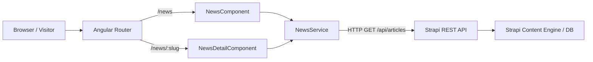

# Requirements

### Overview & Goals
Integrate Strapi Headless CMS with the SDL Angular website to power dynamic, multilingual news articles. Users will be able to browse a responsive list of published news stories with pagination/filtering and navigate to dedicated article pages to read the full content.

### Scope
- **In Scope**:
  - Step-by-step Strapi CMS schema definition for `Article` collection type with i18n enabled (`en`, `mk`, `sr`).
  - Strapi Public API permissions setup for fetching articles and media.
  - Angular environment configuration for direct Strapi REST API connectivity.
  - TypeScript interfaces for Strapi data models and query parameters.
  - `NewsService` for fetching paginated article collections and single articles by slug with localization support.
  - `NewsComponent` list page with category filters, responsive cards, cover image fallbacks, and pagination.
  - `NewsDetailComponent` dedicated article route (`/news/:slug`) displaying rich text content, metadata, and breadcrumb navigation.
  - Multilingual localization support in English, Serbian, and Macedonian.
- **Out of Scope**:
  - News comment system or user submissions.
  - Strapi admin custom plugin development.

### User Stories
- **As a site visitor**, I want to browse the latest news and announcements with cover images, dates, and summaries so that I stay informed about the organization's activities.
- **As a site visitor**, I want to click any news card to open a dedicated article page (`/news/:slug`) so that I can read the full text and share the link directly.
- **As a multilingual reader**, I want the news list and article content to automatically reflect my selected language (`en`, `sr`, `mk`).
- **As a content manager**, I want to manage news articles, localized text, and cover media directly inside Strapi CMS and have changes instantly reflected on the website.

### Functional Requirements
- **News List View (`/news`)**:
  - Display page header with localized title and subtitle.
  - Render articles in a responsive multi-column card grid (featured image, publication date, category badge, title, excerpt, "Read More" button).
  - Support category filtering (e.g. All, Announcements, Press, Events).
  - Handle loading skeletons/spinners, empty states ("No news found"), and error notifications.
  - Support pagination or "Load More" fetching.
- **News Detail View (`/news/:slug`)**:
  - Fetch article by slug for the current active locale.
  - Display full cover banner, publish date, author, category, full formatted content body, and "Back to News" action.
  - Handle "Article not found" state gracefully with a back navigation CTA.
- **Language Synchronization**:
  - Listen to `TranslateService.onLangChange` to automatically refresh articles in the chosen language.

# Technical Design

### Current Implementation
- `src/app/website/news/news.component.ts` and `news.component.html` currently exist as minimal placeholder files displaying only an `<h1>News</h1>`.
- `src/app/app.routes.ts` maps path `news` to `NewsComponent`.
- The application uses standalone Angular components with `TranslateModule` / `TranslateService` for internationalization (`en`, `mk`, `sr`) and `HttpClient` for API requests.
- Environment settings reside in `src/environment.ts`.

### Key Decisions
- **Direct Strapi REST API**: Fetch news directly from Strapi REST endpoints (`/api/articles`) from Angular using `HttpClient` for straightforward CMS querying, flexible query parameters (`populate=*`, `locale=...`, `filters[...]`), and decoupled deployment.
- **Dedicated Route Presentation (`/news/:slug`)**: Use route-based navigation (`news/:slug`) for full articles rather than modal popups, enabling clean URLs, browser history, bookmarks, and deep links.
- **Locale-Aware Data Querying**: Pass `locale=${currentLang}` to Strapi REST queries and listen to `TranslateService.onLangChange` to keep UI strings and CMS content in sync.

### Architecture Diagram


### Data Models & Contracts (`src/app/website/news/news.models.ts`)
```typescript
export interface StrapiImageFormat {
  url: string;
  width: number;
  height: number;
}

export interface StrapiMedia {
  id: number;
  attributes?: {
    url: string;
    alternativeText?: string;
    formats?: {
      thumbnail?: StrapiImageFormat;
      small?: StrapiImageFormat;
      medium?: StrapiImageFormat;
      large?: StrapiImageFormat;
    };
  };
  // Strapi v5 flat format compatibility
  url?: string;
  alternativeText?: string;
}

export interface NewsArticle {
  id: number;
  documentId?: string;
  title: string;
  slug: string;
  excerpt?: string;
  content: string;
  category?: string;
  publishedAt: string;
  author?: string;
  isFeatured?: boolean;
  coverImage?: StrapiMedia;
}

export interface StrapiMetaPagination {
  page: number;
  pageSize: number;
  pageCount: number;
  total: number;
}

export interface StrapiListResponse<T> {
  data: T[];
  meta: {
    pagination: StrapiMetaPagination;
  };
}

export interface StrapiSingleResponse<T> {
  data: T;
}
```

### Components & Routes
- `src/app/environment.ts`:
  - Add `strapiUrl: isDevMode() ? 'http://localhost:1337' : 'https://cms.yourdomain.com'`.
- `src/app/website/news/news.service.ts`:
  - `getArticles(page: number, pageSize: number, category?: string): Observable<StrapiListResponse<NewsArticle>>`
  - `getArticleBySlug(slug: string): Observable<NewsArticle | null>`
  - Helper to resolve absolute media URLs from relative Strapi media paths (`${strapiUrl}${media.url}`).
- `src/app/website/news/news.component.ts`:
  - Standalone component with signals for articles list, pagination state, active category, loading flag, and error message.
- `src/app/website/news/news-detail/news-detail.component.ts`:
  - Standalone component fetching route param `:slug`, loading the single article from `NewsService`, and rendering full article markup.
- `src/app/app.routes.ts`:
  - Add `{ path: 'news/:slug', component: NewsDetailComponent }`.

### File Structure
```
src/
├── environment.ts
├── assets/i18n/
│   ├── en.json
│   ├── mk.json
│   └── sr.json
└── app/
    ├── app.routes.ts
    └── website/
        └── news/
            ├── news.models.ts
            ├── news.service.ts
            ├── news.component.ts
            ├── news.component.html
            ├── news.component.scss
            └── news-detail/
                ├── news-detail.component.ts
                ├── news-detail.component.html
                └── news-detail.component.scss
```

### Risks & Mitigations
- **Relative Image URLs**: Strapi returns relative image URLs (`/uploads/...`).
  - *Mitigation*: Provide an image resolution utility inside `NewsService` that prepends `strapiUrl` when the URL is relative.
- **Rich Text / Blocks Content**: Strapi provides rich text in Markdown or JSON Blocks.
  - *Mitigation*: Format standard rich text / paragraph blocks or markdown safely with sanitized HTML rendering.
- **Missing Translations in Strapi**: An article might not be localized in all 3 languages.
  - *Mitigation*: Gracefully handle empty query results or fallback to available locales without application crashing.

# Strapi CMS Setup

### 1. Strapi Content-Type Builder Configuration

Create a new **Collection Type** named `Article` (API ID: `article`, plural: `articles`).

#### Fields Definition:
1. `title` - **Text** (Short text), Required, Internationalized.
2. `slug` - **UID** (Target field: `title`), Required.
3. `excerpt` - **Text** (Long text), Internationalized.
4. `content` - **Rich Text** (Markdown or Blocks), Required, Internationalized.
5. `category` - **Enumeration** (values: `general`, `announcements`, `press`, `events`) or **Text** (Short text).
6. `coverImage` - **Media** (Single image, formats allowed: images).
7. `author` - **Text** (Short text) or Relation to User.
8. `isFeatured` - **Boolean** (Default: false).

#### Internationalization (i18n) Settings:
- In Strapi **Settings -> Internationalization**, ensure the following locales are enabled:
  - English (`en`) - Default
  - Serbian (`sr-Latn` or `sr`)
  - Macedonian (`mk`)
- In `Article` collection type settings, enable **Enable localization for this Content-Type**.

---

### 2. API Roles & Permissions Configuration

To allow the Angular frontend to fetch articles without authentication tokens:
1. Navigate to **Settings** -> **Users & Permissions Plugin** -> **Roles**.
2. Click the **Public** role.
3. Under the **Article** collection type permissions, check:
   - `find` (GET `/api/articles`)
   - `findOne` (GET `/api/articles/:id`)
4. Click **Save**.

---

### 3. Querying Strapi from Frontend (REST API Examples)

- **Get Paginated News in Current Locale with Media populated**:
  ```http
  GET /api/articles?locale=en&populate=*&sort[0]=publishedAt:desc&pagination[page]=1&pagination[pageSize]=6
  ```
- **Filter by Category**:
  ```http
  GET /api/articles?locale=en&populate=*&filters[category][$eq]=announcements&sort[0]=publishedAt:desc
  ```
- **Get Single Article by Slug**:
  ```http
  GET /api/articles?locale=en&populate=*&filters[slug][$eq]=annual-assembly-2025
  ```

---

### 4. Sample Strapi JSON Response Structure
```json
{
  "data": [
    {
      "id": 1,
      "documentId": "abc123xyz",
      "title": "Annual Assembly Held in Skopje",
      "slug": "annual-assembly-held-in-skopje",
      "excerpt": "Key resolutions and future directions were discussed during the annual session.",
      "content": "Full article text with detailed information...",
      "category": "announcements",
      "publishedAt": "2025-05-10T14:30:00.000Z",
      "coverImage": {
        "id": 10,
        "url": "/uploads/assembly_photo.jpg",
        "alternativeText": "Assembly session hall"
      }
    }
  ],
  "meta": {
    "pagination": {
      "page": 1,
      "pageSize": 6,
      "pageCount": 1,
      "total": 1
    }
  }
}
```

# Testing

### Validation Approach
Verify the Strapi news integration on the frontend by testing HTTP requests, component rendering, locale changes, pagination, and routing flows.

### Key Scenarios
- **News Listing Display**:
  - Verify that navigating to `/news` triggers an HTTP GET to Strapi's `/api/articles` with correct query parameters (`populate=*`, `locale=...`, `sort=publishedAt:desc`).
  - Verify cards render the cover image (or placeholder if null), title, excerpt, formatted date, and category tag.
- **Category Filtering & Pagination**:
  - Verify selecting a category pill filters the displayed articles.
  - Verify pagination buttons correctly increment the `page` param and fetch subsequent pages.
- **Article Navigation**:
  - Verify clicking a news card navigates to `/news/:slug`.
  - Verify `NewsDetailComponent` loads the corresponding article content, media banner, and metadata.
  - Verify clicking the "Back to News" link returns the user to the news list.
- **Multilingual Switching**:
  - Switch language between English, Serbian, and Macedonian using the header language switcher.
  - Verify `NewsService` re-fetches data with `locale=mk` or `locale=sr` and that both UI labels and Strapi content update accordingly.

### Edge Cases
- **Article Not Found**: Entering an invalid or expired slug on `/news/:slug` renders a friendly "Article Not Found" alert with a return button rather than an unhandled error.
- **Strapi Offline / API Error**: If the Strapi server is unreachable, the news view displays a user-friendly error state with a retry option.
- **Missing Cover Image**: Articles without an uploaded cover image display a stylized fallback image.
- **Empty Category**: Selecting a category with no published articles shows a clean empty state message.

# Delivery Steps

### ✓ Step 1: Configure environment, data models, and i18n translations
Environment configuration and TypeScript models are established for Strapi news integration.

- Add Strapi base URL configuration (`strapiUrl`) to `src/environment.ts`.
- Create `src/app/website/news/news.models.ts` declaring interfaces for `NewsArticle`, Strapi media attributes, query filters, pagination, and API response envelopes.
- Add news-related UI translation keys across `src/assets/i18n/en.json`, `src/assets/i18n/mk.json`, and `src/assets/i18n/sr.json`.

### ✓ Step 2: Implement Strapi NewsService client
NewsService is implemented to fetch news list and single article data from Strapi REST endpoints.

- Create `src/app/website/news/news.service.ts` injecting `HttpClient` and `TranslateService`.
- Implement `getNewsArticles(page, pageSize, category?)` querying `/api/articles` with populate parameters, active locale, sorting, and pagination.
- Implement `getArticleBySlug(slug)` or `getArticleById(id)` querying `/api/articles` filtered by slug/id with full population for media and localization.
- Add error handling and response normalization to transform Strapi REST responses into clean frontend model structures.

### ✓ Step 3: Build News list component with responsive grid and filters
The news listing page displays a responsive grid of news cards with loading, empty, and pagination states.

- Update `src/app/website/news/news.component.ts` to manage signals/observables for article listings, active category filters, pagination, and loading/error states.
- Rebuild `src/app/website/news/news.component.html` with a modern hero header, category filter pills, responsive card grid (cover images, badges, publish date, title, excerpt), and pagination controls.
- Style `src/app/website/news/news.component.scss` matching the existing design system and responsive breakpoints.
- Wire language change subscriptions via `TranslateService.onLangChange` to automatically reload news for the active locale.

### ✓ Step 4: Implement dedicated News detail page and routing
Dedicated news detail route and component display full article content with routing and navigation.

- Create `src/app/website/news/news-detail/news-detail.component.ts`, `.html`, and `.scss` to render article header, metadata, cover banner, rich content body, and a "Back to News" button.
- Register child route `news/:slug` in `src/app/app.routes.ts`.
- Bind click actions from `NewsComponent` cards to navigate to `/news/:slug`.
- Implement 404 / article not found fallback handling when a slug does not match any published content in the selected language.